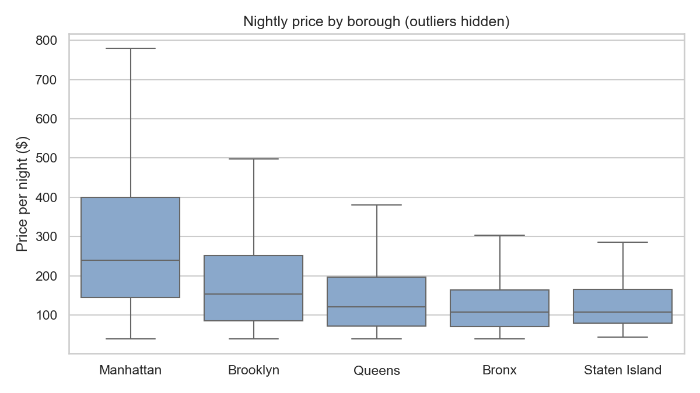
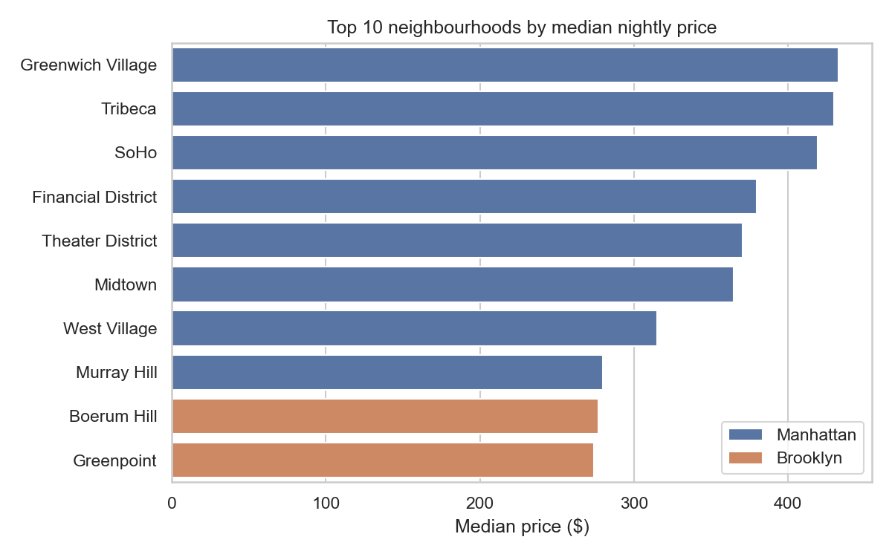
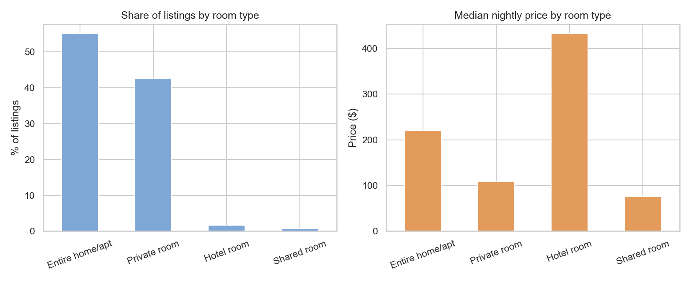
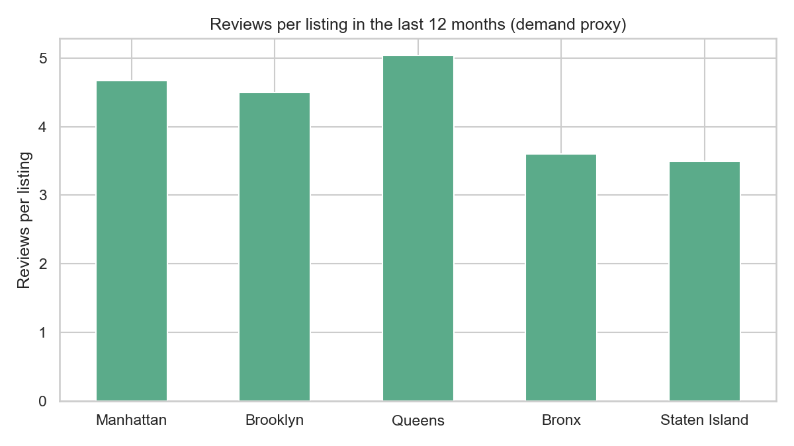
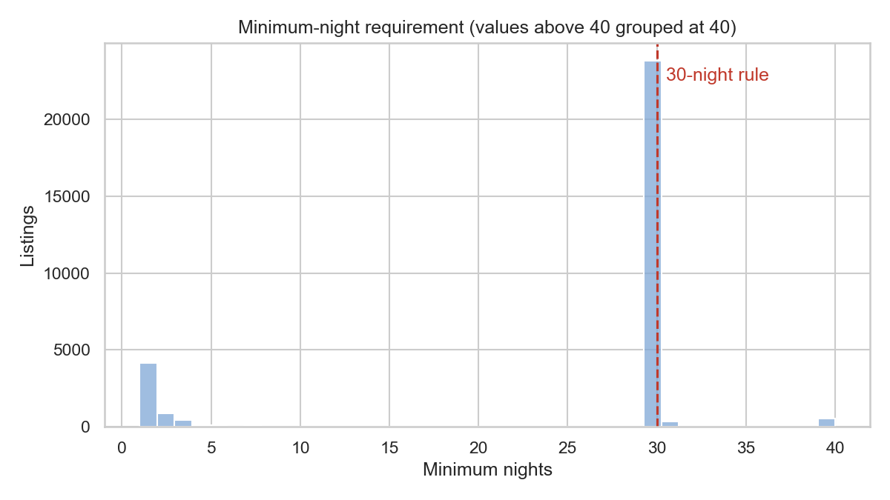
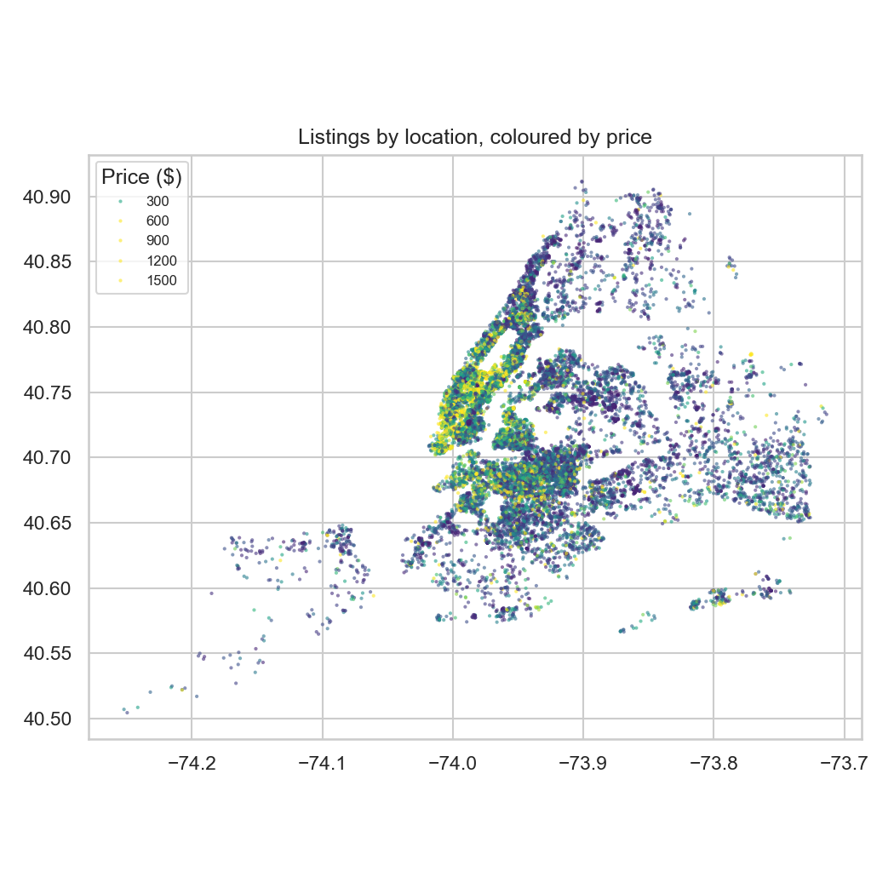

# NYC Airbnb Market Analysis

An exploratory analysis of **30,555 New York City Airbnb listings** (Inside Airbnb snapshot, June 2026) looking at pricing, demand, room types, host concentration and the effect of NYC's short-term rental law.

**Tools:** Python, pandas, Matplotlib, Seaborn

## Key findings

1. **Location drives price.** The city-wide median is **$176/night**. Manhattan is **36% above** that ($239); the Bronx and Staten Island are **39% below** ($108). Eight of the ten most expensive neighbourhoods are in Manhattan, led by Greenwich Village, Tribeca and SoHo (all $420+).
2. **Regulation has reshaped the market.** Since Local Law 18 (Sept 2023) requires registration for stays under 30 nights, **81% of listings now require a 30+ night minimum** — they operate as monthly rentals rather than holiday lets.
3. **Short-term listings still win on demand and price.** The 19% of listings that accept stays under 30 nights are **3x as likely to be active** (76% vs 25% reviewed in the last year) and have a **median price twice as high** ($299 vs $143).
4. **Much of the supply is dormant.** **29%** of listings have no price and only **35%** received a review in the past 12 months.
5. **Supply is concentrated.** **56%** of listings belong to multi-listing hosts, and **27%** to hosts with 10+ listings — likely commercial operators rather than individuals renting a spare room.

## Recommendations (for a host or property investor)

- **Short-term hosts:** registered short-term listings face little competition and command roughly 2x the nightly rate — registration is worth the effort where eligible.
- **Budget travellers / new hosts:** Queens has the highest reviews per listing (5.0) at a median price 31% below the city — strong demand, lower entry cost.
- **Platform / policy view:** with most listings pushed to 30+ nights and many dormant, headline listing counts overstate the real short-term rental supply.

## Charts

| | |
|---|---|
|  |  |
|  |  |
|  |  |

Full numbers: [results.md](results.md)

## Method

- **Cleaning:** 8,758 unpriced listings were excluded from price analysis; prices outside the 1st–99th percentile ($39–$1,702) were removed as outliers; missing review values were treated as zero reviews.
- **Demand proxy:** reviews in the last 12 months (`number_of_reviews_ltm`). Not every stay leaves a review, so this measures relative rather than absolute demand.
- **Neighbourhood rankings** only include neighbourhoods with 50+ priced listings.
- **Short-term** = minimum stay under 30 nights (NYC's legal threshold).

## Limitations and next steps

- Listed price is the asking price, not the price actually paid.
- One snapshot only — comparing with a pre-2023 snapshot would measure the law's impact directly.
- Next: build a price-prediction model (e.g. regression on location, room type and reviews) and an interactive Power BI dashboard.

## Run it yourself

```bash
pip install -r requirements.txt
python analysis.py
```

Data source: [Inside Airbnb](https://insideairbnb.com/get-the-data/) — New York City, `visualisations/listings.csv`, 14 June 2026 (CC BY 4.0).
